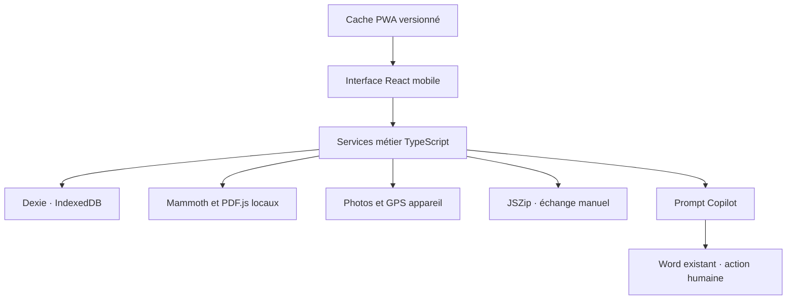

# Architecture MOE Terrain V0.1

## Contrat produit

L’application conserve les constats, leur évolution et les preuves photographiques. Le Word officiel est importé en lecture uniquement. La sortie est un prompt et des données de mise à jour ; aucune génération de DOCX complet.

L’installation initiale et les mises à jour nécessitent la distribution HTTPS de fichiers statiques. Les traitements et les données chantier sont locaux. Une fois le cache complet préparé, aucune connexion à un serveur applicatif n’est requise.

## Architecture technique



Next.js App Router est exporté statiquement (`output: export`). La V0.1 utilise une seule page applicative : navigation locale entre espaces, sans routes dynamiques nécessitant un serveur. Cette simplification remplace les routes séparées envisagées dans la première architecture. Les modules documentaires et PDF sont chargés à la demande mais précachés en production.

### Structure

```text
src/
  app/          page statique, layout, Tailwind et styles
  components/   TerrainApp, ObservationEditor, PDFViewer, PhotoCard
  lib/
    models.ts       types et schémas Zod
    db.ts           tables et index Dexie
    services.ts     mutations métier atomiques
    documents.ts    extraction et validation des candidats
    gps.ts          acquisition bornée de la position
    copilot.ts      format du prompt
    archives.ts     export, contrôle et import atomique
public/
  branding/     logo fourni
  icons/        SVG source et variantes PNG
  pdf/          worker PDF.js embarqué au build
scripts/        préparation, précache, icônes et essais navigateur
.github/        publication GitHub Pages
```

## Modèle métier

Un projet possède des réunions et des observations. Une observation conserve son UUID et son numéro lisible. Elle peut être revue pendant plusieurs réunions. L’état courant est matérialisé dans `observations` ; chaque mutation ajoute un événement avec l’état avant et après. Une séquence par observation garantit l’ordre même si l’horloge est corrigée.

- Suppression réversible des observations et réunions via une corbeille (V0.1.1).
- Clôture avec motif obligatoire.
- Réouverture avec commentaire obligatoire.
- Un contrôle sans modification reste un événement.
- Plusieurs réunions peuvent être ouvertes pour corriger une réunion antérieure ; les mutations ciblent la réunion sélectionnée.
- Les points ouverts sont copiés au programme de la réunion suivante, sans duplication des observations.
- La clôture crée un snapshot et un prompt dans la même transaction.
- Réouverture possible : ancien snapshot et prompt archivés dans meetingRevisions, puis nouveau bilan à la clôture.
- L’auteur est un nom local, pas une identité authentifiée.
- Les dates d’événements viennent de l’horloge de l’appareil : pas d’horodatage certifié.

## Schéma IndexedDB complet

La version 1 définit les tables suivantes. UUID partout sauf la clé `settings.key`. Le caractère `&` signifie index unique ; `[...]` désigne un index composé.

| Table               | Champs métier                                                                                                                             | Index                                                                                          |
| ------------------- | ----------------------------------------------------------------------------------------------------------------------------------------- | ---------------------------------------------------------------------------------------------- |
| projects            | id, name, clientName, reference, createdAt, updatedAt                                                                                     | id, updatedAt                                                                                  |
| meetings            | id, projectId, date, type, status, resumeMarker, createdAt, closedAt?, previousMeetingId?, sourceDocumentId?                              | id, projectId, [projectId+date]                                                                |
| observations        | id, projectId, number, createdMeetingId, title, description, lot, company, status, priority, author, gps, createdAt, updatedAt, closedAt? | id, projectId, [projectId+status], &[projectId+number]                                         |
| observationEvents   | id, projectId, observationId, meetingId, sequence, kind, comment, before, after, author, recordedAt, gps                                  | id, projectId, observationId, meetingId, [observationId+recordedAt], &[observationId+sequence] |
| meetingObservations | id, meetingId, observationId, toCheck, checkedAt?, outcome?                                                                               | id, &[meetingId+observationId], meetingId, observationId                                       |
| photos              | id, projectId, observationId, eventId, originalName, mimeType, image Blob, addedAt, gps, gpsSource                                        | id, projectId, observationId, eventId                                                          |
| plans               | id, projectId, name, createdAt, file Blob                                                                                                 | id, projectId                                                                                  |
| planMarkers         | id, projectId, planId, observationId, page, x, y, createdAt                                                                               | id, projectId, [planId+page], planId, observationId                                            |
| sourceDocuments     | id, projectId, meetingId, name, format, text, createdAt, file Blob                                                                        | id, projectId, meetingId                                                                       |
| reviewCandidates    | id, meetingId, sourceDocumentId, text, page?, decision, observationId?                                                                    | id, meetingId, sourceDocumentId                                                                |
| meetingSnapshots    | id, meetingId, projectId, closedAt, groupes d’IDs, observations figées, événements, photoIds, resumeMarker, sourceDocumentId?             | id, &meetingId, projectId                                                                      |
| generatedArtifacts  | id, projectId, meetingId, kind, text, createdAt                                                                                           | id, meetingId, projectId                                                                       |
| settings            | key, value                                                                                                                                | key                                                                                            |

### Objets imbriqués

`ObservationState` contient titre, description, lot, entreprise, statut et priorité.

`GPS` contient un état parmi `captured`, `denied`, `timeout`, `unavailable`, `unsupported`. Si capturé : latitude, longitude, précision en mètres et heure de mesure.

`Snapshot` contient les identifiants des observations nouvelles, modifiées/suivies, clôturées, bloquantes et non contrôlées. Les états sont ceux de la clôture. L’historique reprend les événements des points concernés jusqu’à la clôture. Les photos du prompt sont celles ajoutées pendant la réunion.

### Transactions

Le GPS et la préparation des fichiers sont exécutés avant l’ouverture de la transaction. La transaction écrit ensemble observation, événement, lien réunion et photos. Un échec annule l’ensemble.

L’import vérifie l’archive avant toute mutation, puis écrit l’ensemble dans une transaction multi-table. Le remplacement efface uniquement le projet explicitement choisi, dans cette même transaction. Les préférences de l’appareil ne sont jamais importées.

### Migration

`db.version(1)` représente le schéma initial. Une évolution doit ajouter une version Dexie et une migration non destructive. Ne jamais supprimer la base pour changer de version. Le format ZIP possède une version distincte ; les versions non prises en charge sont rejetées explicitement.

## Arborescence React

```text
Page (chargement navigateur uniquement)
  TerrainApp
    barre latérale / navigation mobile
    barre d’état local et hors ligne
    liste projets / formulaire projet
    espace projet
      réunions et programme de contrôle
      liste observations et filtres
      fiche observation et timeline
        PhotoCard
      espace plans
        PDFViewer + couche de repères
      synthèse clôturée et prompt
      transfert ZIP
    Sheet accessible avec maintien du focus
      ObservationEditor
      préparation du CR
      clôture de réunion
      préférences
      validation d’import
```

Les services sont séparés de l’interface. `useLiveQuery` maintient les vues à jour après validation des transactions.

## Design system

| Token                       | Valeur                                              |
| --------------------------- | --------------------------------------------------- |
| principal                   | #1D2D44                                             |
| turquoise de marque         | #38ABAE                                             |
| bouton turquoise foncé      | #23797C, pour renforcer le contraste du texte blanc |
| accent vert                 | #57CC99                                             |
| fond                        | #F5F7F9                                             |
| surface                     | #FFFFFF                                             |
| texte secondaire            | #667589                                             |
| séparateur                  | #E1E7EB                                             |
| arrondis                    | 8 à 12 px, panneaux 16 px                           |
| typographie                 | Calibri, Segoe UI, Arial                            |
| cibles tactiles principales | 48 px minimum                                       |

Les états comportent texte, symbole et couleur. Sur mobile : barre basse, filtre horizontal, formulaires en panneau inférieur. Le formulaire rapide masque lot, entreprise, statut et priorité dans « Détails ».

Les wireframes sont livrés en SVG dans `docs/wireframes.svg` pour être lisibles et exportables.

## PWA

`prepare.mjs` copie le worker PDF et écrit le manifeste avec le chemin de publication. `precache.mjs` collecte les fichiers `out/`, calcule un nom de cache à partir de leur contenu et crée le service worker final.

- Installation atomique du cache : si un fichier manque, le cache incomplet est supprimé et le worker ne s’installe pas.
- Le message « Prêt hors ligne » nécessite un contrôle de présence de tous les fichiers.
- Cache séparé par chemin d’installation ; une autre application MOE Terrain du même domaine n’est pas nettoyée.
- Ressources servies depuis le cache de la version active.
- Nouvelle version en attente jusqu’à fermeture des anciennes fenêtres.
- Pas de mise à jour forcée pendant une saisie.
- Cache applicatif distinct d’IndexedDB.

## Archives

`manifest.json` porte version, projet, date et empreintes SHA-256 des entrées. Les métadonnées binaires sont exportées séparément des Blob. UUID et noms de fichiers restent stables au transfert.

La copie indépendante remappe tous les UUID et régénère les prompts pour corriger les références de photos. Le remplacement nécessite une sauvegarde téléchargée puis une confirmation explicite. Pas de fusion silencieuse.

Les empreintes détectent une corruption accidentelle ; elles n’authentifient pas l’expéditeur du ZIP.

## Copilot

Le prompt n’est jamais exécuté dans l’application. Il demande une modification limitée aux sections situées après le marqueur unique. Il distingue changements, levées, blocages et contrôles non effectués. Les données extraites sont désignées comme contenu source, pas instructions.

Les photos locales ne deviennent pas accessibles à Copilot parce que leur chemin figure dans le texte. Elles doivent être fournies manuellement. Le maître d’œuvre valide le résultat dans Word avant diffusion.

## Évolution 0.1.1

La base passe à la version 2, en conservant toutes les données. Ajout de `meetingRevisions` (id, projectId, meetingId, archivedAt, reason, snapshot, prompt ; index id, projectId, meetingId). Les réunions et observations portent un `deletedAt` facultatif ; les points masqués par suppression de réunion portent `deletionMeetingId`. Les médias peuvent porter `bytes: ArrayBuffer` en plus du Blob. Les métadonnées ZIP excluent ces octets, les fichiers binaires restent dans leurs dossiers. Le format ZIP est 2 et l’import accepte aussi le format 1.
